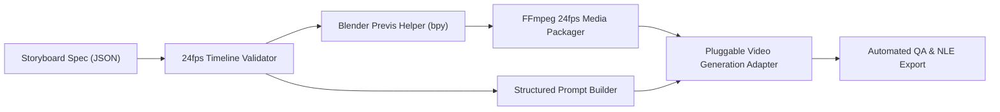

# ClayDirector 🎬

**An Open-Source 3D Previs & Generative Video Pipeline Toolkit for Independent Animation**

[](LICENSE)
[](https://www.python.org/)
[](https://www.blender.org/)
[](README_zh.md)

**ClayDirector** is a lightweight, vendor-agnostic Python toolkit that connects structured storyboards, neutral 3D previs scenes (Blender), FFmpeg media packaging, and pluggable generative video backends into a reproducible engineering workflow.

---

## 🎯 Motivation

Independent animation teams experimenting with generative video often run into fragmented tooling: storyboard spreadsheets fall out of sync with 24fps edit timelines, camera blocking in Blender is disconnected from prompt metadata, and batch rendering/encoding requires brittle ad-hoc scripts.

**ClayDirector** aims to provide a clean, modular open-source foundation:
- **Typed Storyboard Schemas**: Single source of truth for shots, durations, 24fps frame counts, camera lenses, and asset references.
- **Blender Previs Helpers (`bpy`)**: Reusable utilities for neutral gray blocking materials, camera lens/DOF setup, and scene organization.
- **Template-Driven Prompt Builder**: Deterministic prompt assembly from structured shot metadata rather than manual copy-pasting.
- **Standard Media Packaging**: Automated FFmpeg command generation for clean 24fps H.264 previs clips.
- **Vendor-Agnostic Backend Interface**: Designed to support pluggable video generation providers and automated quality checks.

---

## 🏗️ Architecture Overview



See [docs/ARCHITECTURE.md](docs/ARCHITECTURE.md) for module design and extension points.

---

## 🚀 Quickstart

### 1. Install (Pure Python Standard Library)

```bash
git clone https://github.com/jclee12321/clay-director.git
cd clay-director
pip install -e .
```

### 2. Validate a Storyboard Sequence

```bash
python -m clay_director.cli validate examples/demo_sequence.json
```

### 3. Build Structured Shot Prompts

```bash
python -m clay_director.cli build-prompt examples/demo_sequence.json --shot DEMO-02
```

### 4. Generate FFmpeg Encoding Plans

```bash
python -m clay_director.cli plan-encode examples/demo_sequence.json --frames-dir ./renders --out-dir ./exports
```

### 5. Run Unit Tests

```bash
python -m unittest discover -s tests -v
```

---

## 📂 Repository Structure

```text
clay-director/
├── README.md
├── README_zh.md
├── LICENSE
├── pyproject.toml
├── docs/
│   └── ARCHITECTURE.md
├── examples/
│   └── demo_sequence.json       # Synthetic 3-shot demo sequence
├── src/clay_director/
│   ├── __init__.py
│   ├── models.py                # Typed shot, camera, and sequence schemas
│   ├── storyboard.py            # JSON loader & 24fps frame validator
│   ├── blender_scene.py         # Blender (bpy) camera & neutral material helpers
│   ├── prompt_builder.py        # Template-driven structured prompt builder
│   ├── media_utils.py           # FFmpeg 24fps clean H.264 command builder
│   └── cli.py                   # Command-line entrypoint
└── tests/
    └── test_pipeline.py         # Automated unit tests
```

---

## 🛠️ Engineering Roadmap

This repository is an early-stage open-source skeleton. Planned engineering milestones include:

- [ ] **Phase 1 · Timeline & NLE Interop**
  - OpenTimelineIO (`.otio`) and EDL import/export for Premiere Pro and DaVinci Resolve.
  - Asset reference integrity checker and batch metadata linter.
- [ ] **Phase 2 · Blender Automation (`bpy`)**
  - Headless camera-switch & multi-shot batch render runner.
  - Procedural rigging & foot-contact verification helpers for cleaner 3D blocking.
- [ ] **Phase 3 · Pluggable Provider Adapters & QA**
  - Unified adapter interface for external video generation APIs with job tracking and cost budgets.
  - Automated post-render checks (resolution, frame rate, audio stream verification, and visual consistency checks).

---

## 📄 License

MIT License — see [LICENSE](LICENSE).
